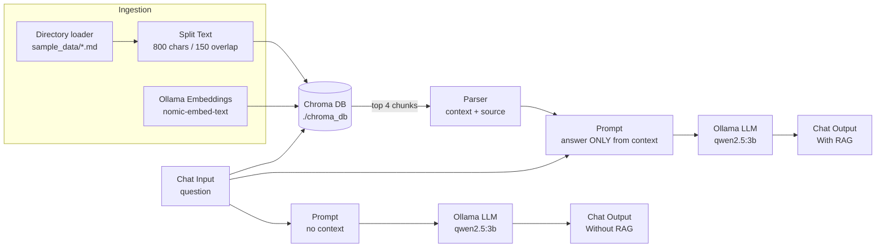
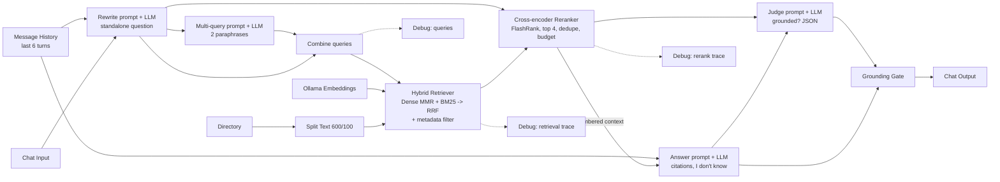

# Design - Onboarding RAG Demo with Langflow + Ollama

## 1. Goal

Show a new joiner's onboarding assistant built in **Langflow** with **local Ollama models**, so the audience can see:

- each RAG stage as a separate component: **loader, splitter, embeddings, vector store/retrieval, prompt, generation**;
- the **same question answered with and without RAG**, side by side;
- how the flow is **exported/imported**, **called over REST**, and **run as plain Python**;
- (presenter only) an **advanced RAG** pipeline for production-grade grounding.

Everything runs locally: no cloud keys and no admin rights needed.

## 2. Repository layout

| Path                                   | Purpose                                                                                  |
| -------------------------------------- | ---------------------------------------------------------------------------------------- |
| `flows/onboarding_rag.json`            | Hands-on flow, import into Langflow                                                      |
| `flows/advanced_onboarding_rag.json`   | Presenter-only advanced flow                                                             |
| `flows/*.py`                           | Same flows written in Python (source of truth, runnable with `lfx run` / `lfx serve`)    |
| `components/`                          | Custom components used by the advanced flow (hybrid retriever, reranker, grounding gate) |
| `sample_data/`                         | Fictional "Orbitly Systems" onboarding docs + a Jira export                              |
| `scripts/check_prereqs.sh` / `.ps1`    | Pre-session environment check                                                            |
| `scripts/import_flows.py`              | Catch-up helper: imports both flows into a running Langflow and creates an API key       |
| `scripts/call_api.py` / `.sh` / `.ps1` | REST API clients                                                                         |
| `scripts/run_flow_python.py`           | Runs the exported JSON as plain Python                                                   |
| `scripts/export_flows.py`              | Regenerates the JSON files from `flows/*.py`                                             |
| `.env.example`                         | Settings for Langflow and the scripts                                                    |

## 3. Architecture - hands-on flow ("Onboarding RAG - Before vs After")



| Stage                    | Component         | Setting                                 | Why                                                                                 |
| ------------------------ | ----------------- | --------------------------------------- | ----------------------------------------------------------------------------------- |
| Loader                   | Directory         | `./sample_data`, `md,txt`               | Swap in **URL** (private wiki/web links) or **Confluence** for real company content |
| Splitter                 | Split Text        | size 800, overlap 150, separator `\n\n` | Paragraph-aligned chunks; overlap keeps facts that span a boundary                  |
| Embeddings               | Ollama Embeddings | `nomic-embed-text` (274 MB)             | Small, strong English retrieval model, runs on CPU                                  |
| Vector store + retrieval | Chroma DB         | persist `./chroma_db`, Similarity, k=4  | No server needed; deduplicates, so re-runs do not re-embed                          |
| Context                  | Parser            | `[source: {file_path}]\n{text}`         | Gives the model the source for citations                                            |
| Generation               | Prompt + Ollama   | `qwen2.5:3b`, temperature 0.1           | Best accuracy-to-size local model for instruction following / grounding (~1.9 GB)   |
| Before/After             | 2 Chat Outputs    | sender names "Without RAG" / "With RAG" | Same model, same persona, same question - only the context differs                  |

The Chroma node **ingests and searches** in the same run. Ingestion is deduplicated, so only new chunks get embedded and the flow can be run any number of times.

### Model choice

| Role       | Default            | Lighter (8 GB RAM laptops)      | Heavier (16 GB+, better answers) |
| ---------- | ------------------ | ------------------------------- | -------------------------------- |
| LLM        | `qwen2.5:3b`       | `qwen2.5:1.5b` or `llama3.2:1b` | `llama3.1:8b` / `qwen2.5:7b`     |
| Embeddings | `nomic-embed-text` | `nomic-embed-text`              | `mxbai-embed-large`              |

To change the model, edit **Model Name** on each Ollama node, or set `LLM_MODEL` for `lfx`. If you change the **embedding** model, delete `chroma_db/` because vectors from different models can't be mixed.

### Using private company sources (Confluence, Jira, intranet links)

- **URL** component: paste private links. Attendees on the corporate network/VPN can reach them. For pages behind SSO, export the pages to HTML/PDF/Markdown into `sample_data/` instead.
- **Confluence** component (bundle): Base URL, username, API token, space key. Store the token as a Langflow **Global Variable** (_Settings > Global Variables_, type _Credential_). Flow exports never include credential values.
- **Jira**: use a Jira export (CSV/HTML) or the Jira REST URL in the **API Request** component. `sample_data/06_jira_known_issues.md` simulates this.
- Connect any extra loader to **Split Text > Data Inputs**. It accepts several inputs.

> Never commit proprietary documents or tokens. `chroma_db/` holds copies of your text, so it is git-ignored.

## 4. Architecture - advanced flow (presenter-only showcase)



### Advanced RAG concepts (explain each in ~1 minute)

| #   | Concept                            | Problem it solves                                                  | How it is done here                                                                        | Use it when                         |
| --- | ---------------------------------- | ------------------------------------------------------------------ | ------------------------------------------------------------------------------------------ | ----------------------------------- |
| 1   | **Conversational memory**          | Follow-ups ("what about contractors?") retrieve nothing useful     | Message History feeds the last 6 turns to the prompts                                      | Any chat UI                         |
| 2   | **Query rewriting**                | Retrieval needs a self-contained question                          | LLM turns the follow-up into a standalone question (temperature 0)                         | Multi-turn chat                     |
| 3   | **Multi-query expansion**          | Users word things differently from the docs                        | LLM writes 2 paraphrases; every query is searched                                          | Low recall, varied vocabulary       |
| 4   | **Dense search + MMR**             | Top-k returns near-duplicate chunks                                | Chroma `max_marginal_relevance_search` (fetch_k 20, k 8, λ 0.5)                            | Repetitive corpora (wikis, tickets) |
| 5   | **Sparse search (BM25)**           | Embeddings miss exact tokens: `ORB-1427`, `OrbitGate`, error codes | `rank_bm25` over the same chunks                                                           | IDs, acronyms, product names, code  |
| 6   | **Hybrid fusion (RRF)**            | Dense and sparse scores aren't comparable                          | Reciprocal Rank Fusion: `Σ 1/(60 + rank)`                                                  | Almost always in production         |
| 7   | **Metadata filtering**             | Wrong department/space/version pollutes answers                    | "source contains" filter (e.g. `jira`)                                                     | Multi-tenant or multi-space data    |
| 8   | **Cross-encoder reranking**        | Bi-encoder similarity is coarse                                    | FlashRank `ms-marco-MiniLM-L-12-v2` (~22 MB, CPU) scores question+chunk pairs, keeps top 4 | Better precision at the top         |
| 9   | **Context compression**            | Duplicates and long context dilute attention                       | De-duplication + character budget + numbered passages                                      | Small local models, long docs       |
| 10  | **Citations + refusal**            | Users can't verify answers, models invent facts                    | Answer must cite `[n]`, must say "I don't know"                                            | Everything user-facing              |
| 11  | **Grounding check (LLM-as-judge)** | Hallucinations slip through                                        | Second LLM call returns `{"grounded": bool}`; the Grounding Gate swaps in a safe fallback  | Compliance, HR/legal answers        |
| 12  | **Observability**                  | "Why did it answer that?"                                          | Debug Text Outputs show queries, dense vs BM25 hits, rerank order                          | Debugging, evaluation               |

**Concepts to explore next (not built):** HyDE (embed a hypothetical answer), parent-document / small-to-big retrieval, semantic chunking, contextual chunk headers, GraphRAG, agentic/corrective RAG (re-retrieve when the judge fails), and evaluation with **RAGAS** / **DeepEval** (faithfulness, context precision/recall, answer relevancy) on a golden question set.

**Cost:** the advanced flow makes 4 LLM calls per question (rewrite, multi-query, answer, judge). Expect roughly 3-4x the latency of the basic flow on CPU.

## 5. Interfaces

| Interface          | How                                                                                                         | Notes                                                                                           |
| ------------------ | ----------------------------------------------------------------------------------------------------------- | ----------------------------------------------------------------------------------------------- |
| Langflow UI        | `http://127.0.0.1:7860` > Playground                                                                        | Both chat outputs are shown for each question                                                   |
| Langflow REST      | `POST /api/v1/run/{flow_id or endpoint_name}?stream=false`, header `x-api-key`                              | Endpoint names: `onboarding-rag`, `advanced-onboarding-rag`. Returns **all** outputs            |
| Tweaks             | `"tweaks": {"VectorStore-Chroma": {"number_of_results": 6}}` in the body                                    | Override any component field per request                                                        |
| Python (no server) | `python scripts/run_flow_python.py "question"` (`lfx.load.run_flow_from_json`)                              | Prints both lanes                                                                               |
| CLI                | `lfx run flows/onboarding_rag.py "question"`                                                                | Python-defined flow; prints the last output                                                     |
| Standalone API     | `LANGFLOW_API_KEY=... lfx serve flows/advanced_onboarding_rag.json --port 8000` then `POST /flows/{id}/run` | Production-style microservice without the UI. Returns a single output, so use the advanced flow |

## 6. Prerequisites (no admin rights needed)

**Hardware:** 8 GB RAM minimum (16 GB recommended), ~4 GB free disk (≈1.5 GB Python packages + ≈2.2 GB models). A GPU is optional.
**Network:** needed only for the one-time downloads (models, packages). The demo itself runs offline.
**Ports:** 7860 (Langflow), 11434 (Ollama), 8000 (optional `lfx serve`).

All steps install into your **user profile**. `uv` downloads its own Python, so no system Python is needed.

### Windows 10/11 (PowerShell, no admin)

```powershell
# 1. uv (installs to %USERPROFILE%\.local\bin)
powershell -ExecutionPolicy ByPass -c "irm https://astral.sh/uv/install.ps1 | iex"
# open a NEW terminal so PATH is refreshed

# 2. Ollama: download OllamaSetup.exe from https://ollama.com/download/windows
#    It installs per-user (%LOCALAPPDATA%\Programs\Ollama), no admin needed. It starts in the tray.
ollama pull qwen2.5:3b
ollama pull nomic-embed-text

# 3. Project
cd RAGDemoProject
uv venv --python 3.12
uv pip install -r requirements.txt          # presenter: requirements-advanced.txt
Copy-Item .env.example .env
powershell -ExecutionPolicy Bypass -File .\scripts\check_prereqs.ps1
uv run langflow run --env-file .env
```

If corporate policy blocks PowerShell scripts, run the `irm ... | iex` line as shown (process-scoped bypass). Or download `uv-x86_64-pc-windows-msvc.zip` from GitHub releases and unzip it to a folder on your user PATH.

### macOS 13+ (Terminal, no admin)

```bash
# 1. uv (installs to ~/.local/bin)
curl -LsSf https://astral.sh/uv/install.sh | sh
source ~/.local/bin/env      # or open a new terminal

# 2. Ollama: download Ollama.dmg from https://ollama.com/download/mac
#    Drag Ollama.app into ~/Applications (your user folder, no admin), then open it.
#    If it offers to install the command line tool (needs admin), skip it and use:
export PATH="$HOME/Applications/Ollama.app/Contents/Resources:$PATH"
ollama pull qwen2.5:3b
ollama pull nomic-embed-text

# 3. Project
cd RAGDemoProject
uv venv --python 3.12
uv pip install -r requirements.txt          # presenter: requirements-advanced.txt
cp .env.example .env
./scripts/check_prereqs.sh
uv run langflow run --env-file .env
```

### Linux (Ubuntu/Debian/Fedora, x86_64, no sudo)

```bash
# 1. uv (installs to ~/.local/bin)
curl -LsSf https://astral.sh/uv/install.sh | sh
source ~/.local/bin/env

# 2. Ollama in your home directory (the official install.sh needs sudo, so it is skipped here)
mkdir -p ~/.local
curl -fsSL https://ollama.com/download/ollama-linux-amd64.tar.zst | tar --zstd -x -C ~/.local
# (ARM64: ollama-linux-arm64.tar.zst. If tar lacks zstd: curl ... | zstd -d | tar -x -C ~/.local)
export PATH="$HOME/.local/bin:$PATH"
ollama serve &                 # keep running (or use a separate terminal)
ollama pull qwen2.5:3b
ollama pull nomic-embed-text

# 3. Project
cd RAGDemoProject
uv venv --python 3.12
uv pip install -r requirements.txt          # presenter: requirements-advanced.txt
cp .env.example .env
./scripts/check_prereqs.sh
uv run langflow run --env-file .env
```

### Fallback options

- **Langflow Desktop** (Windows/macOS installer, https://www.langflow.org/desktop): import the same JSON files. It doesn't need the `uv` steps, but the directory path must be absolute.
- **Docker** (if already installed): `docker run -p 7860:7860 -e LANGFLOW_RESTRICT_LOCAL_FILE_ACCESS=false -v "$PWD:/app/demo" langflowai/langflow:1.12.5`. Set the Ollama URL to `http://host.docker.internal:11434` and the paths to `/app/demo/...`.

### Important settings (`.env`)

| Variable                              | Value                               | Why                                                                                                                                    |
| ------------------------------------- | ----------------------------------- | -------------------------------------------------------------------------------------------------------------------------------------- |
| `LANGFLOW_RESTRICT_LOCAL_FILE_ACCESS` | `false`                             | Langflow 1.12 blocks local paths by default. The demo reads `./sample_data` and writes `./chroma_db`. Keep it `true` on shared servers |
| `LANGFLOW_AUTO_LOGIN`                 | `true`                              | Single-user local mode, no login screen                                                                                                |
| `LANGFLOW_API_KEY`                    | from _Settings > Langflow API Keys_ | Required for REST calls                                                                                                                |

**Start Langflow from the project root.** The flows use the relative paths `./sample_data` and `./chroma_db`, and the Directory component only reads inside the folder Langflow was started from.

## 7. Security notes

- The REST API always requires an `x-api-key`. Don't expose port 7860 beyond `127.0.0.1` with auto-login on.
- Credentials go in Global Variables, which are not exported. `.env` and `chroma_db/` are git-ignored.
- The custom components run Python inside Langflow. Only import flows from trusted sources.
- Don't index Restricted/customer data into a local demo vector store.
